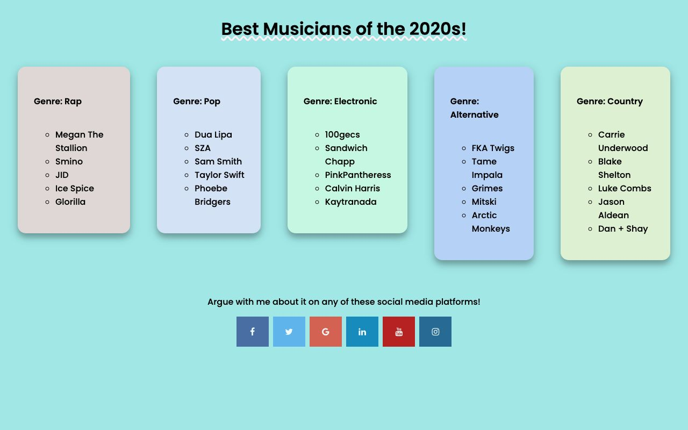
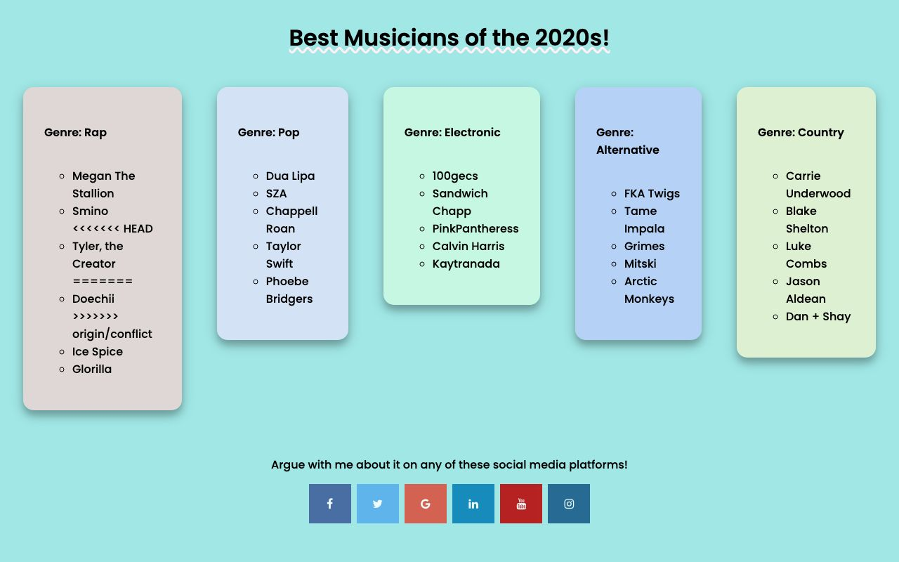

# Your first merge conflict

A hands-on lesson on Git merge conflicts, built around a small page of the best musicians of the 2020s. You'll make a change, merge someone else's work, hit a real conflict, and fix it.



## About this lesson

I made this page for the Fall 2022 cohort at Justice Through Code, a program for adults impacted by the criminal legal system who are learning software engineering. We used it right as students were starting their group projects, so they could understand some of the challenges of working with Git before they ran into them on their own.

In class, I ran it as a live demo: two branches changed the same artist, and we merged them together to watch the conflict happen and resolve it. Then students went into their groups, where they already had project repos, and made and resolved a merge conflict of their own.

After this, students felt more comfortable using Git and resolving conflicts. We didn't formally assess the lesson, since the goal was comfort with Git, but fewer students came to office hours with Git questions, and mentors said most project groups came to them with conceptual design questions rather than procedural Git questions.

Looking back, I would have automated the demo instead of relying on live demo work. Live demos raise the potential for mistakes and errors that aren't related to the demo itself, and that makes the demo more stressful. This self-guided version works that way: the practice branches are prepared ahead of time, so every merge behaves the same way each time.

- **Who it's for:** people who've used `git commit` and `git branch` but haven't run into a conflict yet
- **Time:** about 30 minutes

By the end, you'll be able to:

| Objective | Where you practice it | How you'll know |
| --- | --- | --- |
| Explain why merge conflicts happen | Section 1 | Quick check, question 4 |
| Predict whether a merge will conflict | The predictions before sections 3 and 4 and the challenge | Your predictions match what Git does, and quick check questions 1–3 |
| Read conflict markers and resolve them | Sections 5 and 6 | Quick check question 5, and the challenge: both new artists end up in each list |
| Check your work and finish the merge, or back out of it | Section 6 and Common mistakes | `git diff --check` prints nothing, the page looks right, and `git status` says the working tree is clean |

## Before you start

You'll need Git (check with `git --version`), a code editor like VS Code, and a web browser. Everything happens on your own computer, so you won't need to push anything or have access to this repo.

```sh
git clone https://github.com/aryndavis/merge-conflict-demo.git
cd merge-conflict-demo
```

Open `index.html` in your browser. That's the page you'll be changing.

## 1. Why conflicts happen

Imagine two friends, Maya and Jordan, are both editing this list on their own branches. Maya decides JID should make room for Tyler, the Creator. Jordan, separately, swaps JID for Doechii. They each commit their change.

When their branches come back together, Git can combine changes to different lines on its own. But both of them changed the same line, and Git has no way to know which artist should win. So it stops and asks a person to decide. That's a merge conflict.

A conflict isn't an error, and nothing is broken. Git is protecting both people's work until someone chooses what to keep.

The rule to remember: if two branches change **different** lines, Git merges them on its own. If they change the **same** line, or lines right next to each other, you get a conflict.

## 2. Make your change

Make your own branch:

```sh
git switch -c my-pick
```

Open `index.html` in your editor and find this line in the Rap list:

```html
<li>JID</li>
```

Replace JID with any artist you'd rather see there. Anyone works except Doechii, and you'll see why soon. Save the file, refresh the page in your browser, and commit:

```sh
git commit -am "Swap JID for my pick"
```

## 3. A merge that just works

Someone else has been editing the page too. Their `clean-merge` branch swaps Sam Smith for Chappell Roan in the Pop list.

**Predict first:** you changed a line in Rap, and they changed a line in Pop. What do you think Git will do when you merge their branch into yours? Write down your guess before running anything.

```sh
git merge --no-edit origin/clean-merge
```

(`--no-edit` keeps Git's default merge message, so it doesn't open a text editor.)

```text
Auto-merging index.html
Merge made by the 'ort' strategy.
 index.html | 2 +-
 1 file changed, 1 insertion(+), 1 deletion(-)
```

Git combined both changes on its own. Refresh the page: your artist and Chappell Roan are both there.

## 4. Your first conflict

The `conflict` branch has one change: someone swapped JID for Doechii.

**Predict first:** this time, you both changed the same line. What will Git do, and what do you think `index.html` will look like afterward?

```sh
git merge --no-edit origin/conflict
```

```text
Auto-merging index.html
CONFLICT (content): Merge conflict in index.html
Automatic merge failed; fix conflicts and then commit the result.
```

Git paused the merge and is waiting for you. `git status` shows where things stand:

```text
On branch my-pick
You have unmerged paths.
  (fix conflicts and run "git commit")
  (use "git merge --abort" to abort the merge)

Unmerged paths:
  (use "git add <file>..." to mark resolution)
	both modified:   index.html
```

"Both modified" means both branches changed this file in the same place. If you ever want to stop and start over, `git merge --abort` puts everything back the way it was before the merge.

## 5. Reading the conflict markers

Open `index.html`. In the Rap list, Git has written both versions of the line into the file:

```text
<<<<<<< HEAD
                <li>Tyler, the Creator</li>
=======
                <li>Doechii</li>
>>>>>>> origin/conflict
```

Your artist will show up in place of Tyler, the Creator. Here's what each part means:

| Marker | Meaning |
| --- | --- |
| `<<<<<<< HEAD` | The start of the conflict. `HEAD` is the branch you're on, so what follows is **your** version. |
| `=======` | The divider between the two versions. |
| `>>>>>>> origin/conflict` | The end of the conflict. What's just above it is **their** version, from the branch you're merging in. |

In VS Code, the two versions are highlighted in different colors, with buttons above them: **Accept Current Change** keeps yours, **Accept Incoming Change** keeps theirs, and **Accept Both Changes** keeps both.

## 6. Resolve it

Decide what the list should say. You can keep your artist, keep Doechii, keep both, or write something new. Then edit the file so it has exactly what you want and none of the markers. Keeping both looks like this:

```html
                <li>Tyler, the Creator</li>
                <li>Doechii</li>
```

Before you commit, check your work:

1. Run `git diff --check`. It points out any conflict markers you missed. No output means none are left.
2. Refresh the page and make sure the Rap list looks right.

Then mark the conflict as resolved and finish the merge:

```sh
git add index.html
git commit -m "Merge conflict: keep both artists"
```

Run `git log --oneline --graph` to see your branch, the two merges, and where the histories came together.

## Common mistakes

**Committing with the markers still in.** Git doesn't stop you from committing a file that still has markers, as long as you've run `git add`. The browser treats the markers as text, so they end up on the page:



Run `git diff --check` and look at the page before every merge commit.

**Committing before running `git add`.** Git refuses, with:

```text
error: Committing is not possible because you have unmerged files.
```

Running `git add index.html` tells Git you've resolved the conflict. It's the step that marks the file as finished.

**Not getting a conflict at all.** If step 4 merged on its own, you either picked Doechii (both branches made the same change, so there's nothing to choose between) or edited a line other than JID. Run `git reset --hard HEAD~1` to undo the merge, change the JID line to a different artist, commit it, and run the merge again.

## Check your understanding

For questions 1–3, decide whether merging the two branches will conflict.

1. You replace SZA in the Pop list, and a teammate replaces Luke Combs in the Country list.
2. You and a teammate both replace Kaytranada in the Electronic list, with different artists.
3. You replace Smino in the Rap list, and a teammate replaces JID, the line right below it.
4. In a sentence or two, explain why Git can't finish the merge in question 2 on its own.
5. You see `>>>>>>> origin/conflict` in a file. Is the version just above it yours, or the other branch's?

<details>
<summary>Answers</summary>

1. **No conflict.** You changed different lines, so Git combines both changes.
2. **Conflict.** You both changed the same line.
3. **Conflict.** The lines are different, but they're right next to each other, and Git treats changes to neighboring lines as a conflict too.
4. Both branches changed the same line in different ways, and Git has no way to know which version is right, so a person has to decide.
5. **The other branch's.** The section between `=======` and `>>>>>>> origin/conflict` comes from the branch you're merging in. Your version is between `<<<<<<< HEAD` and `=======`.

</details>

## Challenge

Start a fresh branch from `main` and merge two more branches, one after the other:

```sh
git switch -c challenge main
git merge --no-edit origin/challenge-a
git merge --no-edit origin/challenge-b
```

Before running each merge, predict whether it will conflict. Then resolve the conflicts so **both** new artists end up in each list they touch. One hint: there's more than one conflict in the file this time.

<details>
<summary>Answer key</summary>

The first merge goes through on its own, because nothing on your new branch changed those lines.

The second merge conflicts twice, because both branches changed the same two lines:

- **Alternative:** challenge-a replaced Grimes with Steve Lacy, and challenge-b replaced Grimes with Clairo.
- **Country:** challenge-a replaced Jason Aldean with Zach Bryan, and challenge-b replaced Jason Aldean with Kacey Musgraves.

Resolved, the two lists look like this:

```html
                <li>FKA Twigs</li>
                <li>Tame Impala</li>
                <li>Steve Lacy</li>
                <li>Clairo</li>
                <li>Mitski</li>
                <li>Arctic Monkeys</li>
```

```html
                <li>Carrie Underwood</li>
                <li>Blake Shelton</li>
                <li>Luke Combs</li>
                <li>Zach Bryan</li>
                <li>Kacey Musgraves</li>
                <li>Dan + Shay</li>
```

`git diff --check` should print nothing, and both cards should show six artists. Then run `git add index.html` and `git commit -m "Resolve the challenge"`.

</details>

## Teaching this in a class

Here's how I'd run it with a group:

1. **Demo (15 minutes):** walk through sections 1 to 6 on a projector using the prepared branches, instead of making changes live. The conflict happens the same way every time, and you won't end up fixing unrelated mistakes in front of the class. Have everyone write down their prediction before each merge, and ask a few people to share theirs.
2. **Practice in project repos (20 minutes):** in their project groups, two teammates each edit the same line of their README on separate branches, then merge both into `main`. The second merge conflicts, and the group resolves it together.
3. **Wrap-up (5 minutes):** go through the quick check questions together, then have each group share how they resolved their conflict.

## The original branches from class

These branches are from teaching the lesson live in Fall 2022. I've kept them as they were, since they show how the page and the lesson were actually used in class.

| Branch | Pull request |
| --- | --- |
| `making_conflicts` | [#2: changed pop](https://github.com/aryndavis/merge-conflict-demo/pull/2) |
| `aryn-edit-electronic` | [#3: Aryn edit electronic](https://github.com/aryndavis/merge-conflict-demo/pull/3) |
| `aryn-merge-conflict` | [#4: forcing merge conflict](https://github.com/aryndavis/merge-conflict-demo/pull/4) |
| `aryn-another-one` | [#5: Aryn another one](https://github.com/aryndavis/merge-conflict-demo/pull/5) |
| `aryn-first-PR` | [#6: Edits to Page Content](https://github.com/aryndavis/merge-conflict-demo/pull/6) |

## The practice branches

The lesson depends on four branches made from `main`:

| Branch | Change | What happens |
| --- | --- | --- |
| `clean-merge` | Sam Smith → Chappell Roan (Pop) | Merges on its own |
| `conflict` | JID → Doechii (Rap) | Conflicts with the learner's edit |
| `challenge-a` | Grimes → Steve Lacy, Jason Aldean → Zach Bryan | Merges on its own |
| `challenge-b` | Grimes → Clairo, Jason Aldean → Kacey Musgraves | Two conflicts after challenge-a |

If you change `index.html` on `main`, keep the `<li>JID</li>` line, and walk through the lesson once to make sure each merge still behaves as described.
